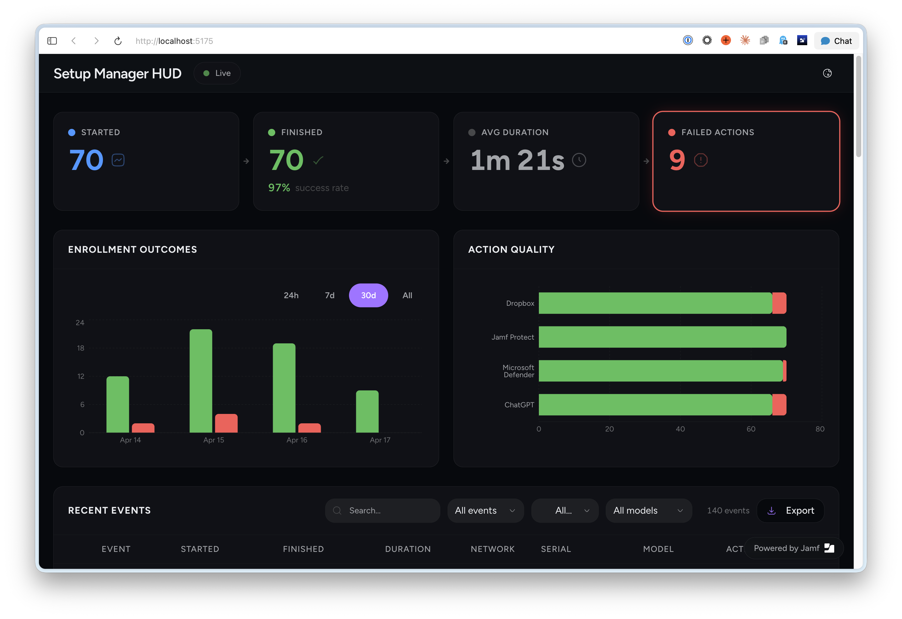
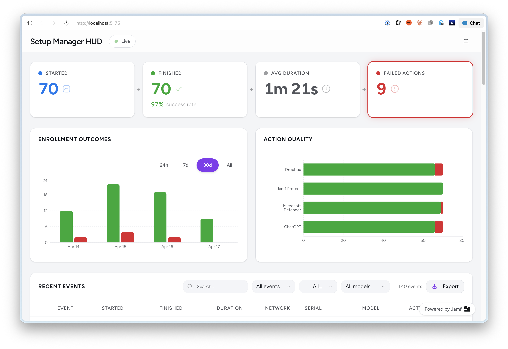

# Setup Manager HUD

A webhook dashboard for [Jamf Setup Manager](https://github.com/jamf/setup-manager). It receives enrollment events from Setup Manager as they happen, stores them, and shows them in a live-updating dashboard.

| Dark Mode | Light Mode |
|-----------|------------|
|  |  |

## What It Does

- Receives webhook events from Setup Manager when devices enroll
- Stores every enrollment — start time, finish time, macOS version, hardware model, success or failure
- Shows a dashboard with charts, stats, and a searchable/filterable table
- Lets you hide test or noise enrollments without deleting them

## Pick a Deployment Option

You don't need to be a developer to deploy this. Choose the option that matches where you want to run it:

| Option | Best for | Cost | Requires |
|--------|----------|------|----------|
| **[Docker / docker-compose](docs/deploy/container.md)** | A server or VM you already have | Your existing server costs | Docker installed on a Linux/Mac machine |
| **[Fly.io](docs/deploy/fly.md)** | Managed cloud, no server to maintain | ~$3–5/month | A free Fly.io account |
| **[Cloudflare Workers](docs/deploy/cloudflare.md)** | Serverless, scales to zero | Free tier likely sufficient | A free Cloudflare account |

> Not sure which to pick? If you have a Mac or Linux server already running at your org, use Docker. If you want something managed with no server to maintain, Fly.io is the simplest paid option. If you want free and serverless, use Cloudflare Workers.

## Before You Deploy (Any Option)

**Generate a webhook token.** This is a random secret that only Setup Manager and your dashboard know. Run this on your Mac:

```bash
openssl rand -hex 24
```

Save the output somewhere safe — like a password manager. You'll use it in two places:
1. When you deploy the dashboard (as `WEBHOOK_TOKEN`)
2. When you configure Setup Manager webhooks (as the `token` value)

If you lose it, you generate a new one and update both sides.

## Deploy Guides

- **[Docker / docker-compose](docs/deploy/container.md)** — run on any machine with Docker
- **[Fly.io](docs/deploy/fly.md)** — managed cloud, always-on, ~$3–5/month
- **[Cloudflare Workers](docs/deploy/cloudflare.md)** — serverless, uses Cloudflare D1 for storage

## After Deploying

### Configure Setup Manager

Add the webhook URL and your token to each webhook in your Setup Manager configuration plist:

```xml
<key>webhooks</key>
<dict>
  <key>started</key>
  <dict>
    <key>url</key>
    <string>https://YOUR-DASHBOARD-URL/webhook</string>
    <key>token</key>
    <string>paste-your-webhook-token-here</string>
  </dict>
  <key>finished</key>
  <dict>
    <key>url</key>
    <string>https://YOUR-DASHBOARD-URL/webhook</string>
    <key>token</key>
    <string>paste-your-webhook-token-here</string>
  </dict>
</dict>
```

Replace `YOUR-DASHBOARD-URL` with the URL from your deployment, and `paste-your-webhook-token-here` with the token you generated.

### Verify It's Working

Check the health endpoint in a browser or terminal:

```bash
curl https://YOUR-DASHBOARD-URL/api/health
```

A healthy response looks like:

```json
{"status":"ok","db":"ok"}
```

Then send a test event to confirm the token is wired up correctly (replace the URL and token):

```bash
curl -X POST https://YOUR-DASHBOARD-URL/webhook \
  -H "Authorization: Bearer your-token-here" \
  -H "Content-Type: application/json" \
  -d '{"name":"Started","event":"com.jamf.setupmanager.started","timestamp":"2025-01-01T00:00:00Z","started":"2025-01-01T00:00:00Z","modelName":"Test Mac","modelIdentifier":"Mac15,3","macOSBuild":"24A335","macOSVersion":"15.0","serialNumber":"TEST001","setupManagerVersion":"2.0.0"}'
```

- **200 OK** — token matched, event stored. Refresh the dashboard.
- **401 Unauthorized** — token mismatch. Double-check both sides have exactly the same value.
- **503 Service Unavailable** — database not reachable. See [Troubleshooting](docs/troubleshooting.md).

## Dashboard

The dashboard auto-refreshes every few seconds. No manual reload needed.

**Active** shows current enrollments. **Disabled** shows ones you've hidden.

To hide a noisy test enrollment from the Active view, click **Disable** on that row. It moves to Disabled and stays in storage — it's not deleted. You can re-enable it any time.

## Optional: Customize the Dashboard

You can set a custom title and logo by adding environment variables when you deploy:

| Variable | Purpose | Example |
|----------|---------|---------|
| `APP_TITLE` | Title shown in the top nav | `Acme Corp Enrollments` |
| `LOGO_URL` | URL to a logo image | `https://example.com/logo.png` |

See your deploy guide for how to set these.

## Documentation

- [Docker / container deploy](docs/deploy/container.md)
- [Fly.io deploy](docs/deploy/fly.md)
- [Cloudflare Workers deploy](docs/deploy/cloudflare.md)
- [Configuration reference](docs/configuration.md)
- [Troubleshooting](docs/troubleshooting.md)

## License

[MIT](LICENSE)
