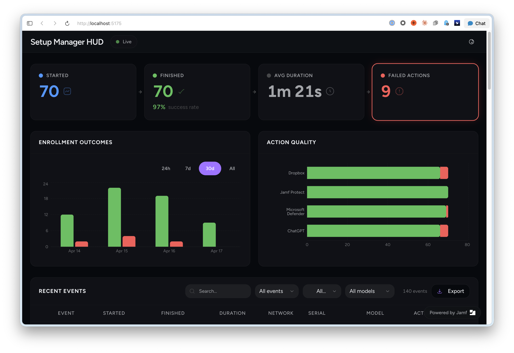
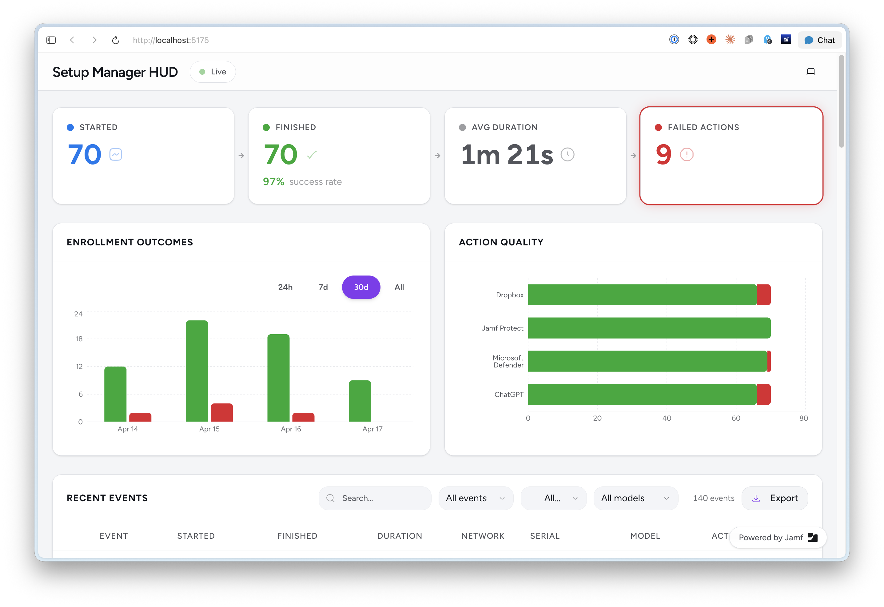

# Setup Manager HUD — Documentation

| Dark Mode | Light Mode |
|-----------|------------|
|  |  |

## Where to start

| I want to… | Go here |
|------------|---------|
| Deploy for the first time | [Docker / container](deploy/container.md) · [Fly.io](deploy/fly.md) · [Cloudflare Workers](deploy/cloudflare.md) |
| Understand configuration options | [Configuration reference](configuration.md) |
| Fix something that's broken | [Troubleshooting](troubleshooting.md) |

Start with the [main README](../README.md) if you haven't yet — it explains the deployment options and walks you through the Setup Manager plist configuration.
